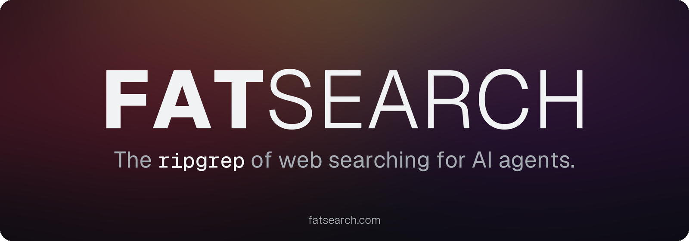

<div align="center">

<a href="https://fatsearch.com"></a>

Reads the pages your agent's built-in fetch can't (JS pages, PDFs) through your own provider key,<br>
kept on disk as clean Markdown, navigated by outline and ids.

<br>

[](https://crates.io/crates/fatsearch)
[](https://www.npmjs.com/package/fatsearch)
[](https://github.com/fatsearch/fatsearch/releases/latest)
[](LICENSE-MIT)

<br>



same question · same answer · 81× less context<br>
**That's the point.**

</div>

<br>

## Every page your agent reads costs you this

<div align="center">

| <sub>Wikipedia · Rust · model input at $2 / M tokens (Claude Sonnet 5.5, 2026-10-19)</sub> | Tokens in context | Fetch | Model bill |
|:--|--:|--:|--:|
| Firecrawl | 112,517 | 1 credit | $0.23 |
| Bright Data Unlocker | 103,625 | 1 request | $0.21 |
| Oxylabs Web API | 102,609 | 1 request | $0.21 |
| Tavily Extract | 97,504 | 0.2 credit | $0.20 |
| Jina Reader | 94,415 | free | $0.19 |
| **FATSEARCH** | **918** | **$0** | **$0.002** |

</div>

Your agent gets a short outline. It reads **one section** when it needs depth, not the whole page.<br>
Menus, cookie banners, navigation, footer links, tracking scripts: gone.<br>
Prices, dates, numbers: kept <sub>(loss guard counts every one)</sub>.

> [!TIP]
> The "free" fetch costs **~100×** more at the model. And it stays in context, every turn after.

<br>

## Your key never touches the chat

`fats setup <provider>` opens a one-time key form on `127.0.0.1`, behind a random token, for 10 minutes.<br>
You paste the key there in your browser, so it stays out of the chat, the model's context and the agent's logs.<br>
The form refuses a POST from another origin; the key is checked live, saved with mode 0600, sent only to its provider.

```console
$ fats setup decodo
= setup decodo · waiting for the key at http://127.0.0.1:59802/k/e0c8baba7a5b058947f4fdab97dabb05/decodo · 10 min · $0
tell the user (never ask for the key in chat):
1. open https://dashboard.decodo.com/web-data/playground  (no account yet: https://dashboard.decodo.com/register)
2. Copy the API key shown on the Web Data playground. Do NOT paste it in this chat.
3. open http://127.0.0.1:59802/k/e0c8baba7a5b058947f4fdab97dabb05/decodo , paste the key, press Save
then: fats setup   (when the user says done; end your turn, do not poll · checks it, $0)
browser not on this machine (SSH)? put the key in the agent's environment as DECODO_AUTH_TOKEN=<key> instead
```

<br>

## On hard pages

`fats` tries plain HTTP first (free). If the page is a JS shell, a captcha, or a wall,
it climbs to your providers: cheapest first, hedged, with cost tracking on every call.

```console
$ fats https://www.nytimes.com/ dry:true
nytimes.com/ fetch plain → oxy (after a captcha) → bd ∥ oxyjs after 5s → new u1 · up to $0.0040

$ fats stats
u1 rust-lang.org · Rust Programming Language · plain 230ms $0.0000 · 1.2ktok
u2 en.wikipedia.org · Rust (programming language… · plain 558ms $0.0000 · 40.9ktok
```

<sub>`fats stats` is the marketing: real numbers, not claims.</sub>

**38 hard pages** <sub>social · news · shops · travel · classifieds · search · one run each</sub>

| answer in the returned text, within | 1 s | 10 s | 20 s | 60 s |
|:--|:-:|:-:|:-:|:-:|
| **FATSEARCH 0.2.0** <sub>2026-10-21</sub> | 12 | 19 | 19 | **35** <sub>/38</sub> |
| Firecrawl <sub>2026-10-16</sub> | 0 | 22 | 24 | 24 |
| Tavily <sub>2026-10-16</sub> | 9 | 17 | 18 | 19 |

<sub>FATSEARCH reads more of the hard pages; Firecrawl and Tavily are faster on the pages they do read (same pages, medians: 23.7 s vs 4.9 s, 23.7 s vs 1.0 s). Readers ran on different days. [Method and every row →](docs/benchmarks.md#results-hard-pages-time-to-an-answer) · the table above: [one page, six readers →](docs/benchmarks.md#one-page-six-readers)</sub>

**Tested in agents** <sub>FATSEARCH 0.1.3 · Claude Code 2.1.280, one run each, 2026-10-19</sub>

- 51 tasks, FATSEARCH MCP vs Firecrawl MCP: 50/51 vs 51/51 right · $15.06 vs $53.48 per 1k tasks · median 5.3 s vs 6.7 s · slowest tenth 43.8 s vs 21.5 s. [Details →](https://fatsearch.com/benchmarks/)
- Claude Code's WebFetch got 403 on npm, Medium and G2; FATSEARCH read all three. [Details →](https://fatsearch.com/benchmarks/)
- One Wikipedia page, open-source readers: FATSEARCH 1,384 tokens to the answer; mcp-server-fetch, Crawl4AI, mcp-searxng and self-hosted Firecrawl 75k–117k for the whole page. [Details →](https://fatsearch.com/benchmarks/)
- Full tables, losses included: [docs/benchmarks.md](docs/benchmarks.md#tested-in-agents-claude-code-51-tasks-fatsearch-mcp-vs-firecrawl-mcp-2026-10-19)

<br>

## Get started

<div align="center">

| <sub>1 · INSTALL</sub> | <sub>2 · KEYS <i>(optional)</i></sub> | <sub>3 · PLUG IN</sub> |
|:-:|:-:|:-:|
| `brew install fatsearch/tap/fatsearch` | `fats setup` | `claude mcp add --scope user fats -- fats mcp` |

<sub>or &nbsp;`curl -fsSL https://fatsearch.com/install.sh | sh`&nbsp; · &nbsp;Windows: `npm i -g fatsearch`&nbsp; · &nbsp;`cargo install --locked fatsearch`&nbsp; · &nbsp;[every host →](docs/installation.md)</sub>

</div>

> [!NOTE]
> The package is `fatsearch`; the command is `fats` (like `ripgrep` → `rg`). Homebrew, npm and the install
> script also add `fatsearch` as a second name for it; `cargo install` adds only `fats`.
> **No account needed.** Without a provider key, `fats` reads what a plain request gets; web search needs an Oxylabs or Bright Data key.
> With **any one key** ([Oxylabs](https://dashboard.oxylabs.io/en/registration), [Bright Data](https://brightdata.com/cp/start) or [Decodo](https://dashboard.decodo.com/register)) it renders and unblocks pages through that provider.

<br>

## Setup

**You, at a terminal:** run `fats setup`. It is a menu (↑↓ Enter): the free fetch and each provider with its
state, then Settings (agent connection, cache, stats, telemetry). Pick a provider, paste its key (hidden), and
`fats` checks it live before it saves it. `fats setup oxy` jumps
straight to one (also `bd`, `decodo`, `gh`).

**Your agent, or no terminal:** the agent runs `fats setup oxy` (or `bd`, `decodo`, `gh`). It prints the
provider's dashboard link and a one-time form on `127.0.0.1`, open for 10 minutes. The agent gives you the URL;
you paste the key into the form in your browser, never into the chat ([what it prints](#your-key-never-touches-the-chat)).
Then the agent runs `fats setup` to check it ($0).

Keys go to `auth.json` in the key dir (mode 0600) and are sent only to their provider. **Environment variables
still work** and win over a saved key, which suits MCP hosts and CI.

| Provider | Key | Page, no JS | Page, rendered | Web search |
|:--|:--|--:|--:|--:|
| free (plain HTTP, your IP) | none | $0 | — | — |
| [Oxylabs](https://dashboard.oxylabs.io/en/registration) Web API | `OXYLABS_WEB_API_KEY` | $0.0010 | $0.0015 | $0.0010 |
| [Bright Data](https://brightdata.com/cp/start) Web Unlocker | `BRIGHTDATA_API_KEY` + `BRIGHTDATA_UNLOCKER_ZONE` | — | $0.0015 | $0.0015 |
| [Decodo](https://dashboard.decodo.com/register) Web Data API | `DECODO_AUTH_TOKEN` | $0.0010 | $0.0015 | — |
| GitHub (`fats gh`) | `GH_TOKEN`, or `fats setup gh` copies the `gh` CLI's token | $0 | — | — |

<sub>List prices per page, the ones `dry:true` and `fats stats` use. Oxylabs and Bright Data spend can be checked
with `fats account`; Decodo has no usage read for this key, so its `$` is the list price, never reconciled.</sub>

**Turn one off** without losing its key: `fats setup oxy off`, back with `fats setup oxy on`.

**The free fetch is your own connection:** one request per page from your IP, at most one start per site per
second; a page waits its turn rather than buying a provider call. Providers use their own IPs and have no pace.
`fats setup free off` sends every page to a provider instead, so every page costs.

<br>

## MCP

**One tool. One string. Same commands.**

```sh
claude mcp add --scope user fats -- fats mcp                      # Claude Code
codex mcp add fats -- fats mcp                                    # Codex
{"mcpServers": {"fats": {"command": "fats", "args": ["mcp"]}}}   # Cursor, Desktop, …
```

<sub>The tool is `fats(cmd)` and its card is ~60 tokens. An agent that knows `fats u1#3` knows the whole tool.<br>
MCP Registry: `mcp-name: io.github.fatsearch/fats`</sub>

<br>

## Commands

| Command | Does |
|:--|:--|
| `fats <url>` | fetch → clean → outline, cached as `u1` |
| `fats u1#3` | read section 3 |
| `fats u1 price` | filter inside the page |
| `fats u1 links` · `fats l4` | numbered links · follow one |
| `fats rust async runtime` | web search → results as ids |
| `fats gh rust markdown` | GitHub repos by stars |
| `fats ./report.pdf` | local file, one section per page |
| `fats stats` | every fetch: provider, ms, cost, tokens |
| `… dry:true` | what would run, what it would cost |

<sub>mods &nbsp;<samp>limit:20 &nbsp;country:de &nbsp;js:true &nbsp;cost:0.5 &nbsp;wait:30 &nbsp;fresh:true</samp> &nbsp;· &nbsp;one screen of all of it: `fats help` &nbsp;· &nbsp;how to use it well: `fats guide`</sub>

<br>

## For agents

The agent skill is versioned in this repo ([skills/fatsearch/SKILL.md](skills/fatsearch/SKILL.md)): how to read
pages without flooding context, and how to install, connect and verify `fats` when it is missing.

```sh
npx skills add fatsearch/fatsearch        # Agent Skills standard: Claude Code, Codex, Cursor, Copilot, Gemini CLI, …
gh skill install fatsearch/fatsearch      # the same through GitHub CLI ≥ 2.90
```

An agent without either CLI reads it pinned to a release:
`https://raw.githubusercontent.com/fatsearch/fatsearch/v0.2.2/skills/fatsearch/SKILL.md`.
That way the agent sees versioned text it can review, and nothing it runs comes from a website.

Docs as plain Markdown for agents: [fatsearch.com/llms.txt](https://fatsearch.com/llms.txt).

<br>

## Telemetry

FATSEARCH shares anonymous usage stats so we can fix what breaks. It never shares what you read or search.

- **Never sent:** URLs, searches, page text, files, API keys, your IP address, any id.
- **Sent:** fatsearch version, OS, which package (npm, Homebrew, cargo…), commands used, errors,
  which providers worked, crashes in our code.

See exactly what's sent with `fats telemetry show`. Turn it off in `fats setup → Settings → Telemetry`,
with `fats setup telemetry off`, `FATS_TELEMETRY=0` or `DO_NOT_TRACK=1`. Details: [docs/telemetry.md](docs/telemetry.md)

<br>

<div align="center">

<kbd> 17–21 MB </kbd> binary &nbsp;&nbsp; <kbd> 4 ms </kbd> start &nbsp;&nbsp; <kbd> 5 ms </kbd> cached read &nbsp;&nbsp; <kbd> $0 </kbd> plain pages &nbsp;&nbsp; <kbd> $0.001–0.0065 </kbd> hard pages (three keys)

<sub>17 MB (macOS arm64) to 21 MB (Linux x86_64) · 4 ms native; the npm shim adds Node's ~40 ms<br>no daemon · no browser · anonymous usage stats (off: `fats setup telemetry off` · `FATS_TELEMETRY=0` · `DO_NOT_TRACK=1`) · [every run →](docs/benchmarks.md)</sub>

</div>

<br>

<details>
<summary><b>What it doesn't do (yet)</b></summary>
<br>

- `match:near` / `match:topic`: needs a local model
- OCR for scanned PDFs → `! no_text`
- DOCX / XLSX → `! not_in_v1 zip`
- OS keychain: keys come from env or `auth.json` (mode 0600)
- Remote MCP: stdio only
- Logins: a page behind a login stays behind it

Each prints a `!` row explaining what's missing and what to do. **Never silence.**
</details>

<br>

<div align="center">
<a href="https://fatsearch.com"><b>fatsearch.com</b></a>
<br><br>
<sub>
<a href="docs/reference.md">reference</a> ·
<a href="docs/benchmarks.md">benchmarks</a> ·
<a href="CHANGELOG.md">changelog</a> ·
<a href="SECURITY.md">security</a> ·
<a href="CONTRIBUTING.md">contributing</a>
<br><br>
MIT or Apache-2.0, at your option.
</sub>
</div>
